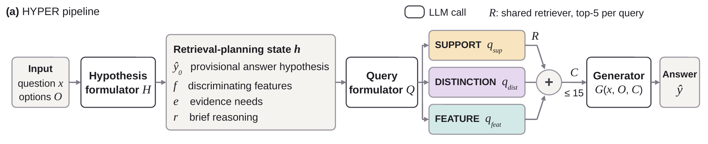

<div align="center">

# HYPER
### Hypothesis-Guided Planning for Evidence-Seeking Retrieval

**Hangeol Chang · Changsun Lee · Seungjoon Rho · Junho Yeo · Jong Chul Ye**

**Findings of EACL 2027**

[Preprint](https://arxiv.org/abs/2603.19008) · [Quick start](#quick-start) · [How it works](#how-it-works) · [Citation](#citation)

**Plan what evidence to retrieve before deciding what answer to give.**

</div>

<p align="center">
  
</p>
<p align="center"><em>The HYPER pipeline, from Figure 1(a) of the paper.</em></p>

HYPER is a training-free retrieval planning method. A provisional answer guides three complementary searches for supporting evidence, distinguishing criteria, and question-specific features. The final generator answers from the retrieved context and can revise the initial hypothesis.

This repository provides the HYPER inference pipeline and evaluation entry point for **MedQA** and **MMLU-Med**.

## Quick start

### 1. Install

Use Linux, Python 3.10+, and a CUDA GPU compatible with vLLM. Install Git, Git LFS, `wget`, and `unzip` for the upstream retrieval resources.

```bash
git clone https://github.com/hangeol/HypothesisRAG.git
cd HypothesisRAG

python -m venv .venv
source .venv/bin/activate
pip install -r requirements.txt
git lfs install
```

### 2. Prepare the questions

```bash
python scripts/prepare_data.py
```

This downloads the MIRAGE benchmark collection and verifies its checksum. The evaluation subsets contain **1,273 MedQA** and **1,089 MMLU-Med** questions. Dataset records stay local.

The first retrieval run prepares the Textbooks corpus and MedCPT index through MedRAG. Allow additional time and disk space for this initial download and indexing step. Model weights are downloaded through Hugging Face; authenticate and obtain access approval where required.

### 3. Run

Start with a small run:

```bash
CUDA_VISIBLE_DEVICES=0 python -m hyper --dataset medqa --limit 5
```

Evaluate either benchmark:

```bash
CUDA_VISIBLE_DEVICES=0 python -m hyper --dataset medqa
CUDA_VISIBLE_DEVICES=0 python -m hyper --dataset mmlu
```

The default model is `Qwen/Qwen3-4B-Instruct-2507`. Choose another model with `--model`:

```bash
CUDA_VISIBLE_DEVICES=0 python -m hyper \
  --model meta-llama/Llama-3.1-8B-Instruct \
  --dataset medqa
```

<details>
<summary><strong>Models and hardware options</strong></summary>

The medical benchmark experiments use these four base models:

| Model | Hugging Face identifier |
| --- | --- |
| Llama 3.2 3B | `meta-llama/Llama-3.2-3B-Instruct` |
| Llama 3.1 8B | `meta-llama/Llama-3.1-8B-Instruct` |
| Qwen3 4B | `Qwen/Qwen3-4B-Instruct-2507` |
| Qwen3 30B-A3B | `Qwen/Qwen3-30B-A3B-Instruct-2507` |

The same model serves hypothesis formation, query formulation, and final generation. GPU memory requirements depend on the model and context length. If a model does not fit on one GPU, use multiple visible GPUs and set `--tensor-parallel-size` accordingly. `--gpu-memory-utilization` controls the vLLM allocation fraction and defaults to `0.85`.

```bash
CUDA_VISIBLE_DEVICES=0,1 python -m hyper \
  --model Qwen/Qwen3-30B-A3B-Instruct-2507 \
  --dataset medqa --tensor-parallel-size 2
```

</details>

### 4. Inspect the results

The terminal reports accuracy and the saved result path. Each JSON file contains the run configuration, aggregate results, and per-question hypotheses, queries, retrieved evidence, and answers.

```text
outputs/<model>/medqa_hyper_<timestamp>.json
```

Use `--output path/to/results` to choose a directory. Inspect settings without loading models with `python -m hyper --dry-run`, or list options with `python -m hyper --help`.

## How it works

| Stage | Input | Output |
| --- | --- | --- |
| **Hypothesis** | Question and answer options | A provisional answer and evidence needs |
| **Query** | Question and hypothesis plan | Support, Distinction, and Feature queries |
| **Retrieve** | Three queries | Top-5 passages per query, fused into at most 15 passages |
| **Answer** | Question, answer options, and retrieved passages | The final answer |

Duplicate passages are merged and ranked by the sum of their retrieval scores. The final answer prompt receives the evidence context without the hypothesis plan. The three prompts are defined in [`hyper/prompts.py`](hyper/prompts.py).

Generation is batched by stage, with each generation stage running in a separate worker process. The paper settings use an **8,192-token context limit**, a **2,048-token output limit**, and **greedy decoding**. MedCPT retrieves from the Textbooks corpus. Runtime and exact outputs can vary with hardware and model, index, and library revisions.

## Repository guide

```text
hyper/
  __main__.py      Command-line entry point
  pipeline.py      Hypothesis → query → retrieval → answer
  prompts.py       The three HYPER prompts
  parsing.py       Model-output parsing
  inference.py     Batched generation workers
  retrieval.py     MedRAG interface
scripts/
  prepare_data.py  Verified benchmark download
MIRAGE/MedRAG/     Upstream retrieval utilities
assets/           Paper illustration
```

## Data and attribution

HYPER builds on [MIRAGE](https://github.com/gzxiong/MIRAGE), [MedRAG](https://github.com/gzxiong/MedRAG), and [MedCPT](https://huggingface.co/ncbi/MedCPT-Query-Encoder). Original notices are retained; source attribution and resource terms are listed in [`THIRD_PARTY_NOTICES.md`](THIRD_PARTY_NOTICES.md).

Benchmark questions, corpus text, model weights, and generated logs are obtained or created locally and excluded from the repository. Review the original resource terms before use or redistribution. This code supports benchmark research; it is not a clinical decision system.

## Citation

```bibtex
@misc{chang2027hyper,
  title  = {{HYPER}: Hypothesis-Guided Planning for Evidence-Seeking Retrieval},
  author = {Chang, Hangeol and Lee, Changsun and Rho, Seungjoon and Yeo, Junho and Ye, Jong Chul},
  year   = {2027},
  note   = {Accepted to Findings of EACL 2027},
  url    = {https://github.com/hangeol/HypothesisRAG}
}
```
